# 实验四：ARMA 建模、模型优化与未来五年预测

完成本地题目要求的三组数据分析：时序图、平稳性与纯随机性检验、ACF/PACF、模型拟合、残差诊断、模型比较与未来五年预测。本阶段只提供代码、图表和分析结果，暂不制作 Word/PDF 实验报告。

## 运行

在仓库根目录使用本机已有的 Anaconda 环境：

```powershell
conda activate base
python exp4/analysis.py
```

也可在 `exp4/` 内运行 `python analysis.py`。程序按脚本位置定位文件，不依赖其他实验目录；重复运行会更新本实验的图表与数值结果，README 保留为分析说明。

本机已有依赖，无需新建环境。其他机器若缺包，可在现有 Anaconda 环境中安装：

```powershell
python -m pip install -r exp4/requirements.txt -i https://mirror.nju.edu.cn/pypi/web/simple
```

本次运行版本为 Python 3.13、NumPy 2.3.5、pandas 2.3.3、Matplotlib 3.10.6、SciPy 1.16.3、statsmodels 0.14.5；库版本也保存在 `results/results.json` 中。

## 数据与预测口径

| 数据 | 含义 | 观测数 | 频率 | 未来五年对应步数 | 预测序号 |
| --- | --- | ---: | --- | ---: | --- |
| E4_1 | 公司盈亏 | 50 | 月度 | 60 | 51–110 |
| E4_2 | 城市人口净流入量 | 48 | 月度 | 60 | 49–108 |
| E4_4 | 城市人口死亡率 | 45 | 年度 | 5 | 46–50 |

数据只有 `t`、`x` 两列，没有日历起点和单位说明。因此横轴使用连续时间序号，数值保留原数据单位，不自行添加年份、货币单位、人数单位或死亡率的百分比/千分比。盈亏的负数表示亏损，人口净流入量的负数可表示净流出，均不截断为零。

计算使用 `doc/E4_1.csv`、`doc/E4_2.csv`、`doc/E4_4.csv`，分别从本地同名 Excel 的 `Sheet1` 提取。三份数据共 143 条，序号连续，无缺失；导出后已逐值核对，与原工作表观测完全一致。原 Excel 的其余两张工作表为空。原 Excel 带有修改者个人元数据，仅保留本地并由本目录 `.gitignore` 排除；CSV 只包含观测数据。

## 方法与模型选择

显著性水平为 5%。ADF 的原假设是存在单位根，KPSS 的原假设是水平平稳；常规检验均含常数项，ADF 以 AIC 选择滞后阶数，KPSS 使用自动带宽。KPSS 的查表边界以 `>0.10` 或 `<0.01` 表示。检验未拒绝原假设不等于证明原假设成立，也不能由此证明严格平稳。

ACF/PACF 展示 1–20 阶，ACF 使用分母 n 的自协方差和 Bartlett 95%逐阶参考区间，PACF 使用 `ywm` 方法及约 ±1.96/√n 的参考区间。样本截尾、拖尾只作模型识别线索；零星高阶越界需要结合拟合诊断判断。区间和检验未作多重比较校正。

原序列列出 Ljung–Box 的 1、6、10 阶结果；10 阶为主要整体检查，1 阶补充考察短期相关，6 阶用于观察结论对滞后数的敏感性。单个滞后范围内未拒绝白噪声假设，并不代表整个序列没有相关性。对含趋势的序列，原始水平值检验不满足常均值平稳前提，需结合去趋势后的建模解释。

基础候选为白噪声、AR(1–3)、MA(1–3)、ARMA(1,1)、ARMA(1,2)、ARMA(2,1)。三组分别比较 20、20、14 个模型：

- E4_1 比较有均值和零均值形式，检验均值项是否有保留必要。
- E4_2 比较常均值形式和线性趋势形式；含趋势 ADF/KPSS 检验也使用相应的 `ct` 设定。
- E4_4 在基础候选之外比较 MA 的 1–3 阶所有非空滞后子集，考察固定部分系数为零的优化。

统一使用 `ARIMA(..., d=0)` 的状态空间极大似然估计，约束 AR 平稳、MA 可逆。所有候选都在同一原始样本上估计，不通过差分来解决确定性趋势；月度数据的 12 阶 ACF/PACF 没有明显季节性证据，因此本实验不拟合季节模型。

选择规则先要求收敛、AICc 有限，且标准化一步预测误差在 6、10 阶的 Ljung–Box p 值均大于 0.05。残差检验自由度扣除实际估计的 AR/MA 系数个数，稀疏模型也按实际系数数量计算。随后在通过诊断的最小 AICc 的 2 以内选择参数最少者，参数数量相同时取 AICc 更小者。这是明确的简约选择规则，不将“最小 AICc”直接等同于唯一正确模型。AICc 的参数数量包含均值/趋势项与创新方差。

所有 54 个候选均收敛。本说明中的“所选/最优”仅指上述候选范围与规则下的结果，不代表所有模型中的全局最优，也不保证样本外预测最佳。模型比较完整数值、参数、根的模和诊断见 `results/*_model_comparison.csv` 与 `results/*_parameters.csv`。

## 平稳性与纯随机性

| 原序列 | ADF统计量 | ADF p值 | KPSS统计量 | KPSS p值 | LB(1) p值 | LB(6) p值 | LB(10) p值 |
| --- | ---: | ---: | ---: | ---: | ---: | ---: | ---: |
| 公司盈亏 | -3.6489 | 0.00489 | 0.1325 | >0.10 | 1.80e-5 | 0.000124 | 0.000183 |
| 人口净流入量 | -4.4918 | 0.000203 | 0.5788 | 0.02457 | 0.000743 | 0.06336 | 0.23725 |
| 人口死亡率 | -5.1870 | 9.35e-6 | 0.1505 | >0.10 | 0.01584 | 0.10125 | 0.01558 |

盈亏、死亡率的 ADF 拒绝单位根，KPSS 未拒绝水平平稳；结合时序图，可按近似平稳序列建模。两者 LB(10) 均拒绝白噪声假设，存在可供建模的线性相关性。死亡率的 LB(6) 未拒绝，说明短样本下结论会受所考察滞后范围影响，不能只选一个有利的 p 值。

人口净流入量的 ADF 拒绝单位根，KPSS 却拒绝水平平稳，不能简单写成“平稳”。含线性趋势的 ADF p=7.58e-6，KPSS p>0.10，与围绕下降趋势波动的解释相容；其均值并非常数。原序列 LB(10) 未拒绝而 LB(1) 拒绝，且原始水平值存在趋势，因此不据 LB(10) 声称原序列纯随机。趋势加 MA 误差模型用于同时描述均值变化和短期相关。

## 1 公司月度盈亏

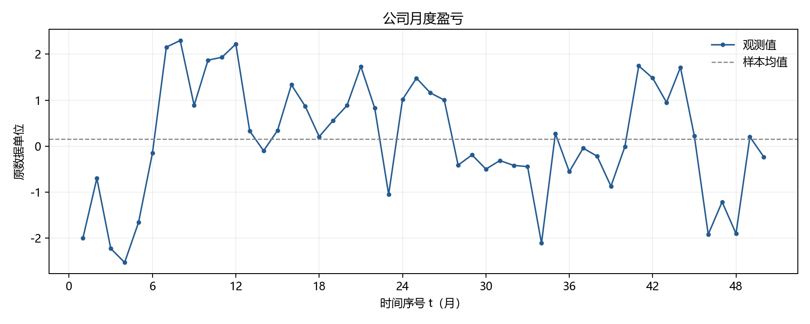

时序图围绕接近零的水平波动。ACF 第 1–3 阶为 0.5887、0.3206、0.1084，总体衰减；PACF 第一阶较突出，后续大多落在参考区间内，支持以 AR(1) 为起点。有限样本 ACF 不会严格等于理论曲线。

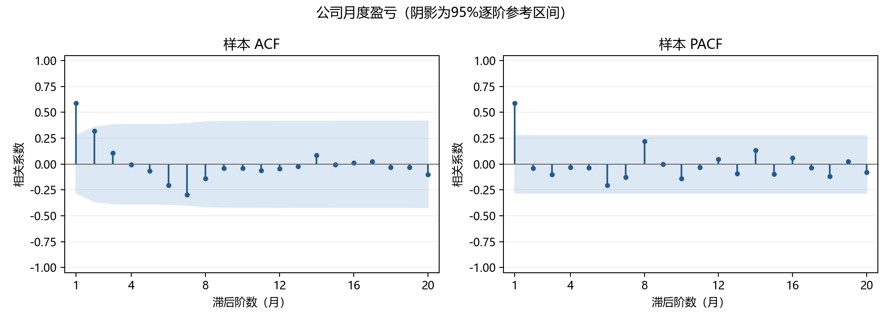

所选模型为零均值 AR(1)：

```text
x_t = 0.618355 x_(t-1) + ε_t
Var(ε_t) = 1.000323
```

零均值 AR(1) 的 AICc=146.6472，含均值 AR(1) 的 AICc=148.8644；后者均值估计约 0.0799，p≈0.818。省去均值项得到更简洁的拟合。所选模型残差 LB(6) p=0.9492、LB(10) p=0.5959，未发现这两个滞后范围内的剩余线性相关。

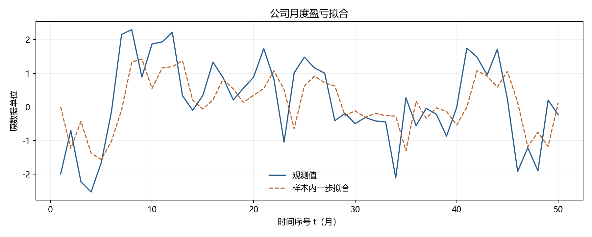

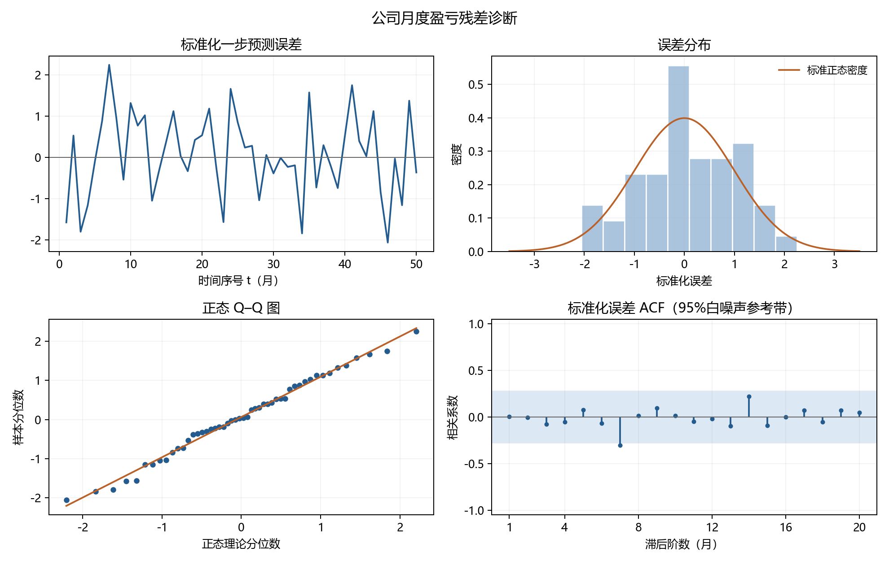

未来前五个月的点预测依次为 -0.1466、-0.0906、-0.0560、-0.0346、-0.0214，随后逐渐回归零均值；第 60 个月约为零，其条件95%预测区间约为 [-2.4943, 2.4943]。趋近零的是点预测，不表示未来不再发生盈亏。

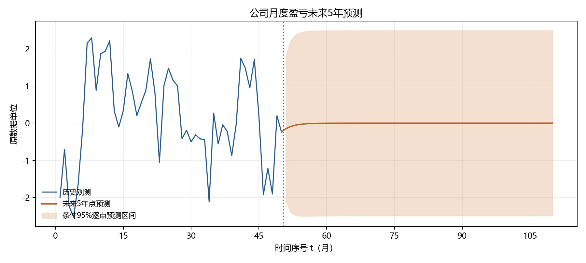

## 2 城市月度人口净流入量

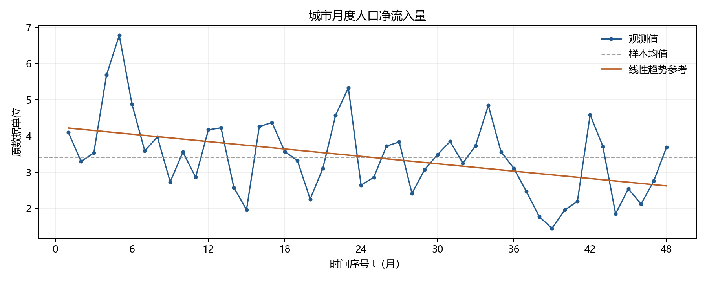

原序列 ACF 第一阶约 0.4720，第二阶起大多较小；PACF 有交替衰减的表现，可考虑 MA(1)。原序列含趋势，因此同时检查去线性趋势后的 ACF/PACF，并比较含趋势的误差模型，不能仅凭原序列图形定阶。

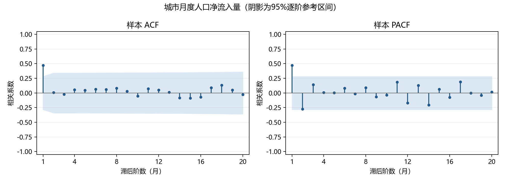

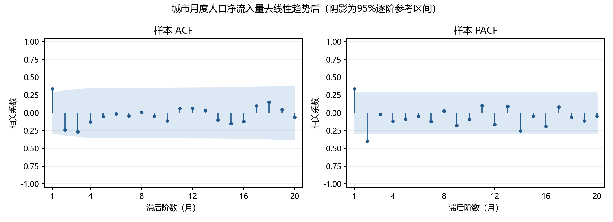

所选模型为线性趋势加 MA(1) 误差：

```text
x_t = 4.239985 - 0.033020 t + u_t
u_t = ε_t + 0.527475 ε_(t-1)
Var(ε_t) = 0.728126
```

这里的 `const` 是趋势线在 t=0 的截距，ARIMA 中的均值/趋势参数按回归项解释。趋势斜率 p≈0.0179。该模型 AICc=130.2461，常均值 MA(1) 的 AICc=133.5153。虽然趋势加 ARMA(1,2) 的 AICc=128.5374 更小，但所选模型与其相差 1.7087，参数更少；复杂模型还出现 MA 参数标准误很大的估计问题。按已声明的简约规则选用趋势加 MA(1)。

所选模型残差 LB(6) p=0.5754、LB(10) p=0.6924，未发现相应范围内的剩余线性相关。

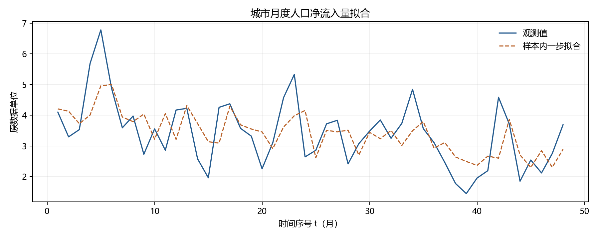

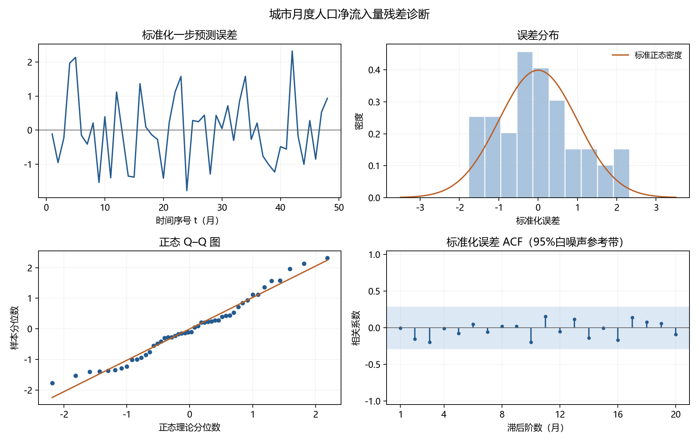

| 未来月数 | 点预测 | 条件95%预测下限 | 条件95%预测上限 |
| ---: | ---: | ---: | ---: |
| 1 | 3.0427 | 1.3702 | 4.7151 |
| 12 | 2.2588 | 0.3680 | 4.1496 |
| 24 | 1.8626 | -0.0283 | 3.7534 |
| 36 | 1.4663 | -0.4245 | 3.3572 |
| 48 | 1.0701 | -0.8208 | 2.9609 |
| 60 | 0.6739 | -1.2170 | 2.5647 |

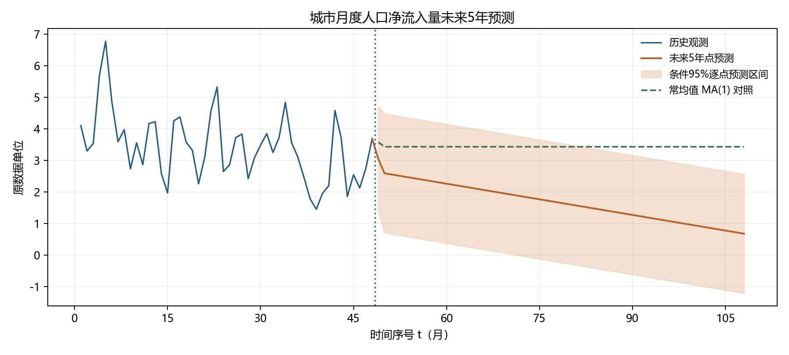

图中另列常均值 MA(1) 的点预测作为敏感性对照，其长期预测趋向约 3.4313，完整对照结果见 `results/e4_2_constant_forecast.csv`。两者在长期有明显差异，表明预测很依赖“下降趋势是否持续”的假设。当前只有四年月度数据，外推五年应作为模型情景，不能将拟合出的下降线直接当作必然的人口发展规律。

## 3 城市年度人口死亡率及模型优化

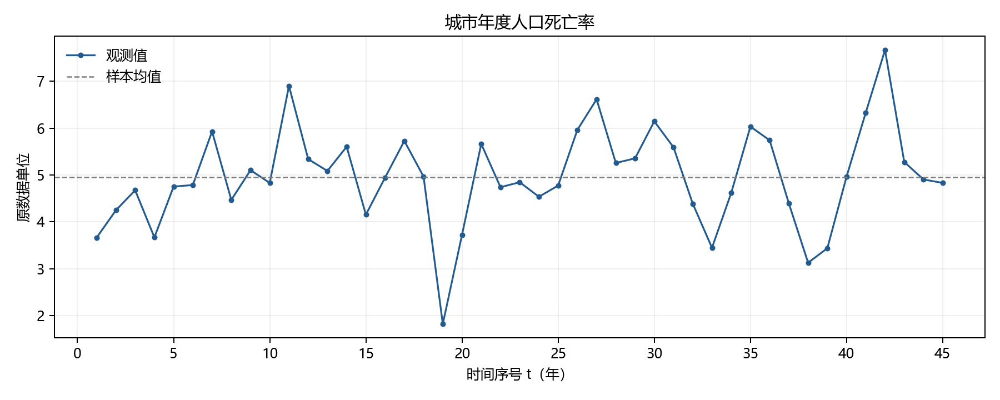

序列围绕约 5 的水平波动。ACF 第 1–3 阶为 0.3480、-0.1686、-0.2391；PACF 前两阶较突出，但第 8、10 阶也有越界，因此 AR(2) 可作为候选，不能认定 PACF 精确二阶截尾。ACF 第 8 阶约 -0.3708，样本图也不支持把某个低阶截尾当作确定事实；需要模型比较与残差诊断。

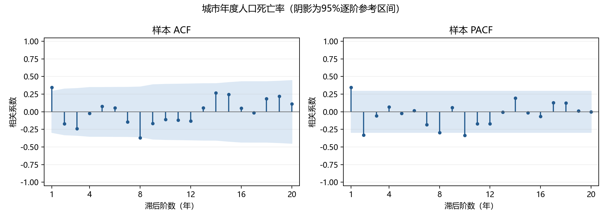

在完整 MA(3) 之外，系统比较保留不同滞后项的稀疏模型。所选模型仅保留第 1、3 阶误差项，即 MA(3) 中固定 θ₂=0：

```text
x_t = 4.960087 + ε_t + 0.592147 ε_(t-1) - 0.407845 ε_(t-3)
Var(ε_t) = 0.783826
```

这仍然是最高滞后为 3 的 MA 模型，不能写成普通 MA(2)。两个 MA 系数的 p 值分别约 4.94e-6、0.000174，所选 MA 多项式最小根模约 1.2006，满足可逆性约束。所选模型残差第 8 阶 ACF 仍有孤立越界；虽然预设的 6、10 阶整体检验未拒绝白噪声，45 条观测仍不足以排除更高阶结构，不能将残差描述为已证明完全随机。

| 模型 | 参数总数 | AICc | BIC | 残差LB(10) p值 | 说明 |
| --- | ---: | ---: | ---: | ---: | --- |
| 均值加白噪声 | 2 | 135.4094 | 138.7370 | 0.0156 | 剩余相关未消除 |
| AR(2) 加均值 | 4 | 129.1235 | 135.3502 | 0.1673 | 可作候选，第二阶 AR 系数 p≈0.0958 |
| MA(1) 加均值 | 3 | 129.0546 | 133.8892 | 0.2495 | 简单候选 |
| 完整 MA(3) 加均值 | 5 | 127.5347 | 135.0296 | 0.0419 | 残差检验未通过，根接近可逆边界 |
| 仅第1、3阶的 MA 加均值 | 4 | 126.8270 | 133.0536 | 0.2126 | 所选模型 |

相对于完整 MA(3)，固定第二阶系数为零后减少一个参数，AICc 下降约 0.7078，残差 LB(10) 由拒绝变为未拒绝，参数标准误也更合理。相对于 MA(1)，所选模型 AICc 改善约 2.2276，已超过本实验的 2 分简约范围。这里比较的是重新估计后的受约束模型，没有仅凭完整 MA(3) 的不稳定 Wald p 值机械删除系数。

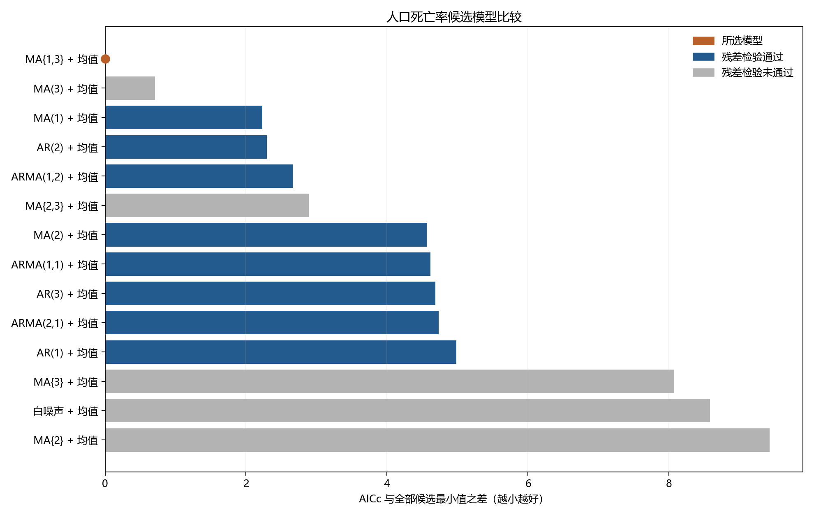

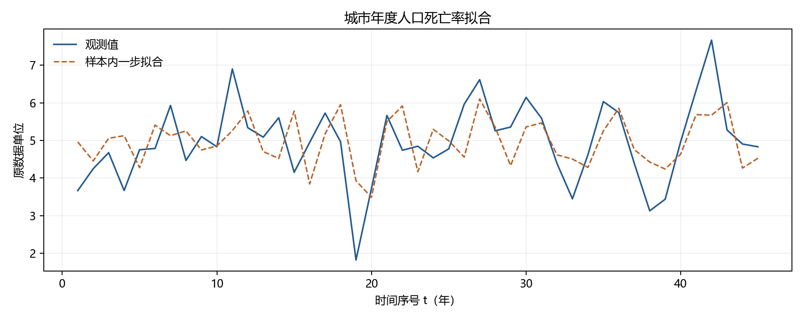

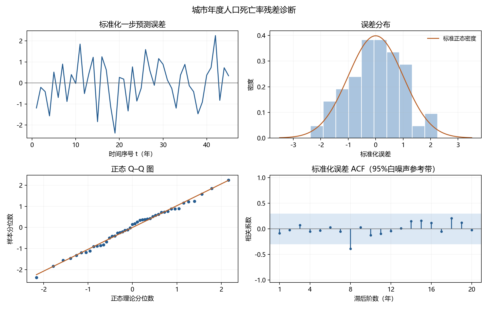

| 未来年数 | 时间序号 | 点预测 | 条件95%预测下限 | 条件95%预测上限 |
| ---: | ---: | ---: | ---: | ---: |
| 1 | 46 | 5.4376 | 3.7024 | 7.1729 |
| 2 | 47 | 4.6992 | 2.6825 | 6.7158 |
| 3 | 48 | 4.8360 | 2.8193 | 6.8526 |
| 4 | 49 | 4.9601 | 2.8229 | 7.0973 |
| 5 | 50 | 4.9601 | 2.8229 | 7.0973 |

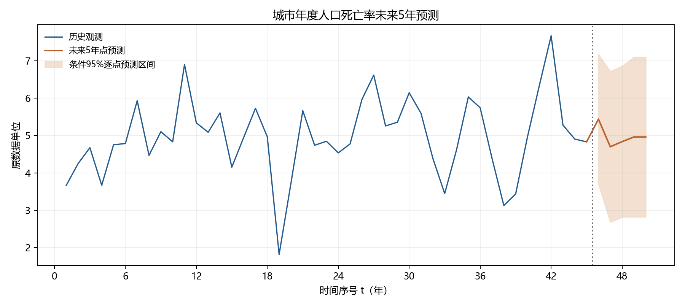

MA(3) 在三步以后已知冲击的影响消失，所以从第 4 步起点预测回到均值。这是模型性质，不是漏算预测。

## 结果文件与解释限制

- `analysis.py`：独立读取三份 CSV 并生成全部分析结果；`requirements.txt`：五个计算/绘图库。
- `figure/`：17 张 PNG。每组包含时序、ACF/PACF、拟合、四联残差诊断、预测各一张，另有净流入量去趋势相关图、死亡率模型比较图。
- `results/diagnostics.csv`：原序列及净流入量含趋势检验，完整列出三个 Ljung–Box 滞后范围；`ct` 行只改变 ADF/KPSS 的趋势设定，该行的 Ljung–Box 仍针对原始观测。
- `results/*_correlations.csv`：各阶相关系数、区间和越界标记。
- `results/*_model_comparison.csv`：全部候选、信息准则、收敛情况、根模、残差检验和选择标记；无相应 AR/MA 项时根模留空。
- `results/*_parameters.csv`、`*_fitted.csv`、`*_residual_ljung_box.csv`：所选模型参数、样本内一步拟合/误差、残差白噪声检验。
- `results/*_forecast.csv`：三组分别 60、60、5 行预测，含步长、序号、点预测和条件95%区间；另有常均值 MA(1) 对照。
- `results/results.json`：主要检验、所选模型、参数、预测、计算设置与库版本。

拟合图和 JSON 中的 RMSE 均为使用全样本估计参数后的样本内一步结果，RMSE 统一从 t=4 起计算，不能当成独立测试集表现。本实验没有声称通过五年样本外回测验证。

预测区间基于高斯创新假设，固定估计参数，属于逐点区间；不覆盖参数估计、趋势持续性、模型选择或结构变化带来的全部不确定性，也不是整条五年路径的联合95%覆盖区间。Q–Q 图和分布图辅助检查创新分布，残差 Ljung–Box 未拒绝只说明所考察范围内没有检测到剩余线性相关，不能证明独立同分布。

本地题目、原 Excel 和任何后续 Word/PDF 报告均不上传；提交内容只包含本实验的非敏感代码、CSV、图表及说明。`AGENTS.md` 按根目录规则仅保留本地。

## 方法参考

statsmodels 官方文档：[ARIMA 与趋势项定义](https://www.statsmodels.org/stable/generated/statsmodels.tsa.arima.model.ARIMA.html)、[Ljung–Box 及自由度修正](https://www.statsmodels.org/stable/generated/statsmodels.stats.diagnostic.acorr_ljungbox.html)、[AICc](https://www.statsmodels.org/stable/generated/statsmodels.tools.eval_measures.aicc.html)、[预测接口](https://www.statsmodels.org/stable/generated/statsmodels.tsa.arima.model.ARIMAResults.get_forecast.html)、[KPSS](https://www.statsmodels.org/stable/generated/statsmodels.tsa.stattools.kpss.html)。实际计算使用上列本地版本，在线 stable 文档可能随版本更新。
