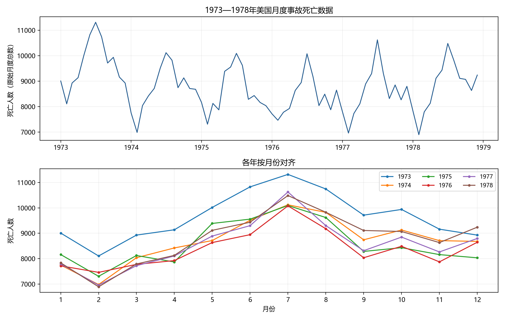
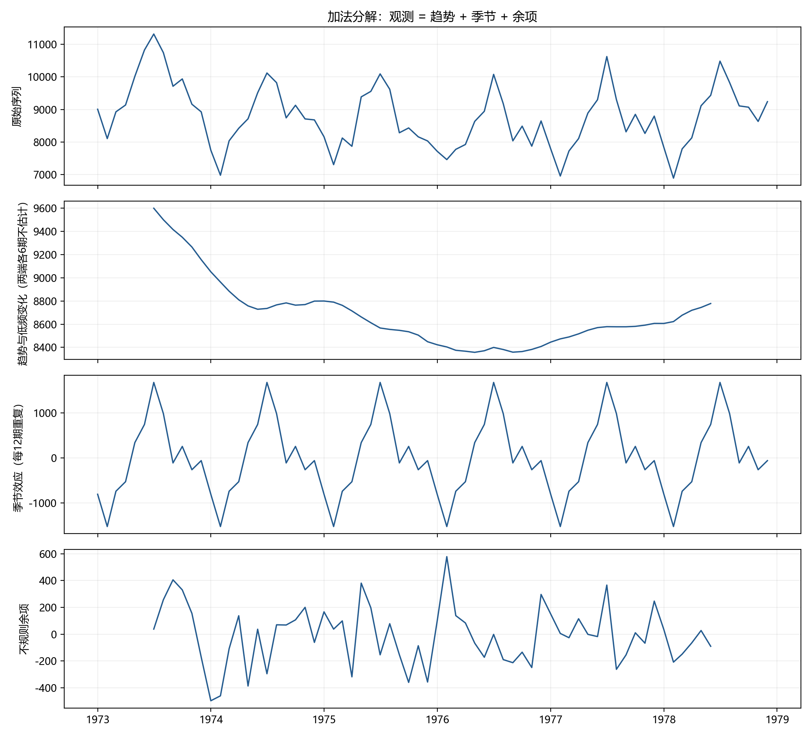
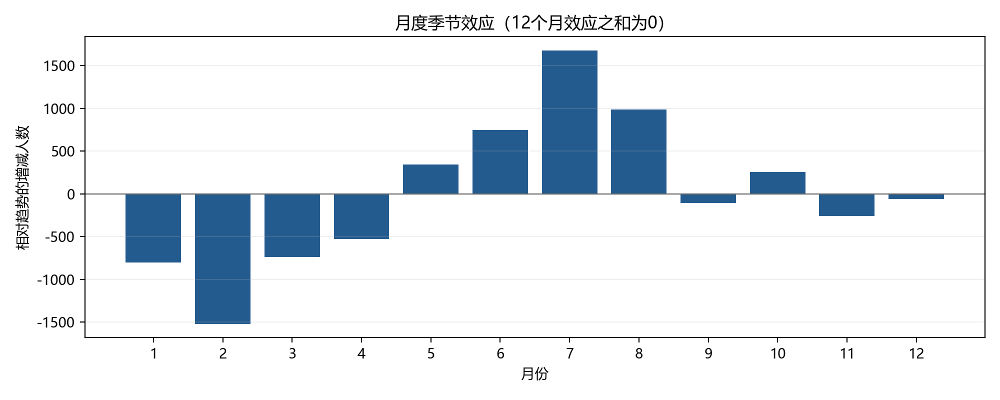
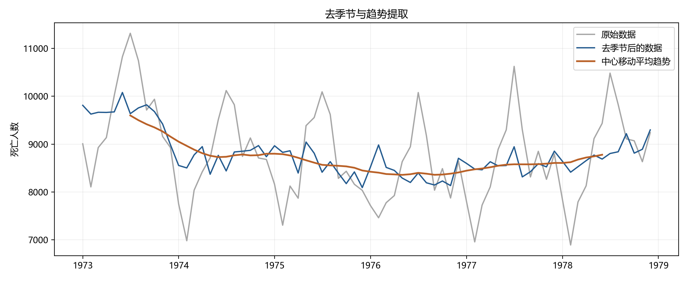
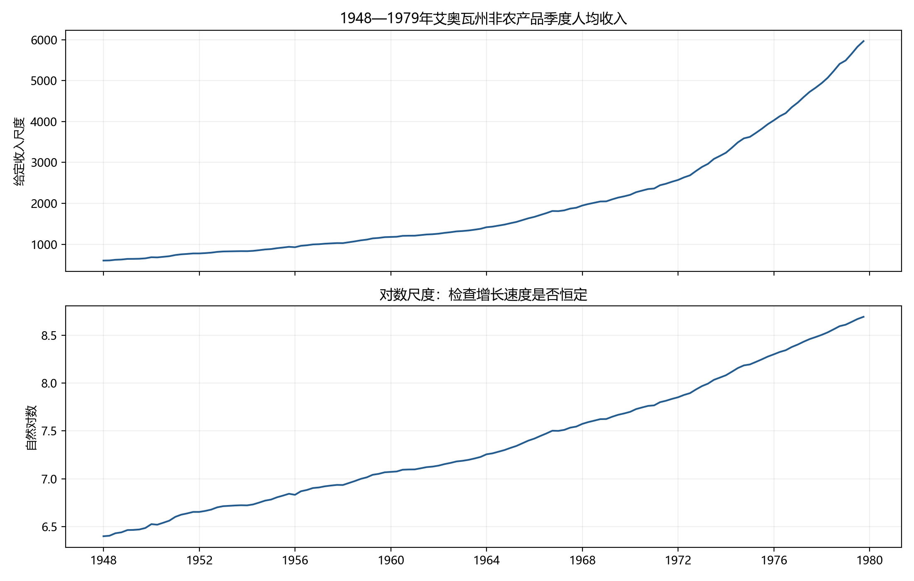
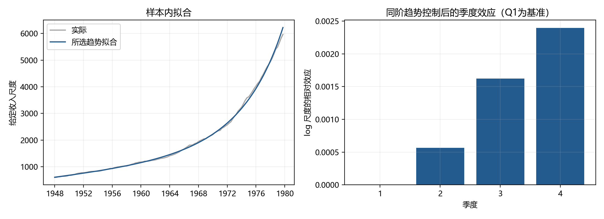
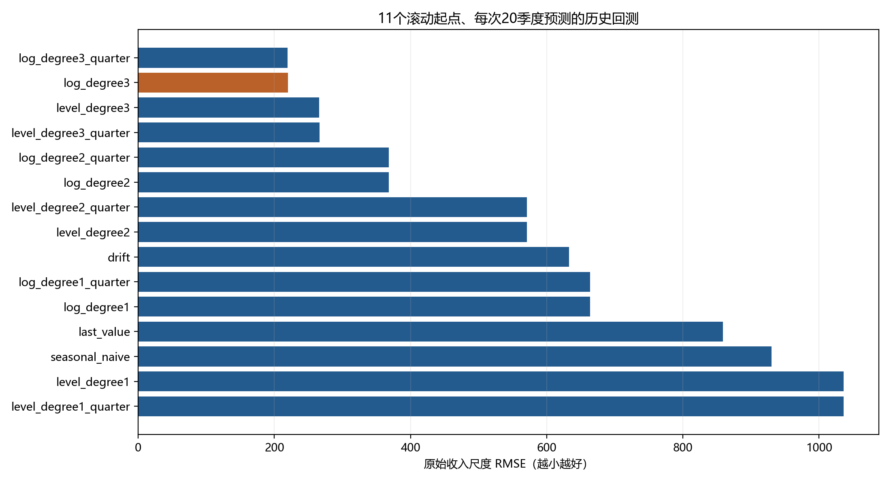
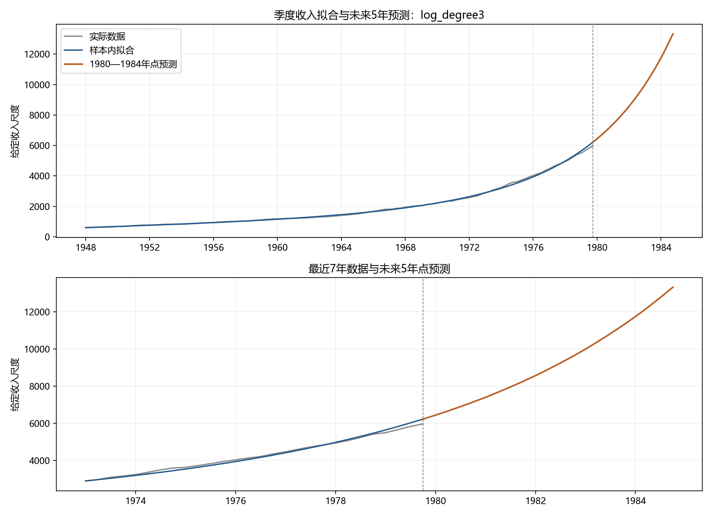

# 实验六：确定性因素分解、趋势拟合与预测

完成本地指导中的两题：1973—1978年月度事故死亡数据的趋势与季节效应提取，以及1948—1979年季度人均收入的时序分析、模型拟合和未来5年预测。代码、输入、图表、数值结果和核验记录均在本目录；本次不生成 Word/PDF 实验报告。

## 运行

在仓库根目录使用本机已有的 Anaconda 环境：

```powershell
conda activate base
python exp6/analysis.py
python exp6/verify_results.py
```

也可进入 `exp6/` 后运行两个脚本。所有路径以脚本所在目录为准，不依赖其他实验。`analysis.py` 更新图表和分析结果，`verify_results.py` 独立复算并更新核验记录及文件哈希清单。

纯数据 CSV 已备好，正常运行不需要原始 Excel。若需从本地教学原件重新提取并逐值核对，再运行：

```powershell
python exp6/prepare_data.py
```

使用现有环境，无需新建环境。本次版本为 Python 3.13.9、NumPy 2.3.5、pandas 2.3.3、Matplotlib 3.10.6、SciPy 1.16.3、statsmodels 0.14.5；运行时版本另存于 `results/results.json`。`openpyxl` 仅供原件提取及原件存在时的核验使用。其他机器缺包时使用南京大学镜像：

```powershell
python -m pip install -r exp6/requirements.txt -i https://mirror.nju.edu.cn/pypi/web/simple
```

## 目录和题目对应

```text
exp6/
├── doc/                 原始指导、Excel（仅本地）及可提交的纯数据CSV
├── figure/              10张200 dpi分析图
├── results/             分解、拟合、回测、预测、核验与哈希清单
├── qa/                  本地运行日志、图表总览及上传检查记录（不提交）
├── .gitignore           原始材料、QA和未来报告的忽略规则
├── .gitattributes       固定文本换行，保证Git检出后哈希一致
├── prepare_data.py      从原始Excel提取CSV并逐值核对
├── analysis.py          完整运行两题
├── verify_results.py    独立复算实际输出并保存核验记录
├── requirements.txt     本实验依赖
└── README.md            运行方法、结果与解释
```

| 指导要求 | 输入 | 实现与结果 |
| --- | --- | --- |
| 第1题：识别确定性因素并选择分解模型 | E6_2.csv，72个月 | 时序图、按年月份对齐图、加法/乘法对照 |
| 第1题：提取趋势效应 | 同上 | 2×12中心移动平均，保存60个有效趋势值 |
| 第1题：提取季节效应 | 同上 | 12个月效应、72期重复季节项、去季节序列 |
| 第2题：画时序图并判断确定性特征 | E6_7.csv，128个季度 | 原尺度和对数尺度时序图、控制趋势后的季度效应 |
| 第2题：选择模型并拟合 | 同上 | 12个趋势候选、3个基线、滚动回测、参数与逐期拟合 |
| 第2题：未来5年预测 | 截至1979Q4的数据 | 1980Q1—1984Q4共20期点预测 |

两个 CSV 的列均为 `time,x`，与 Excel `Sheet1` 共200行、200个观测逐值一致，无缺失、重复日期或时间断档，其他工作表为空。月度日期为月初，季度日期为季初，季度标识采用日历季度。原件未修改，源文件与 CSV 的 SHA-256 见 `results/source_audit.json`。

两份 Excel 均含修改者元数据，因此本目录 `.gitignore` 将原始 Excel、指导 Word、未来报告和 QA 文件留在本地。Git 仅留档纯数据与分析成果。收入材料未明确货币单位、计量倍率、名义/实际口径及是否经过季节调整，因此沿用给定尺度，不自行补写美元、千美元或通胀调整口径。

## 第1题 月度事故死亡数据

原序列具有明显的12个月重复模式，同时水平先下降、后缓慢回升。这里的“趋势”是移动平均提取的低频变化，包含可能的较长周期成分；6年数据不足以将更长周期与趋势单独分离。月度总人数的季节项也可能包含月份长短等日历差异，分解结果不能解释为某种因素的因果效应。

主结果采用加法模型：

```text
x_t = T_t + S_month(t) + R_t
T_t = (x_(t-6) + x_(t+6))/24 + (x_(t-5) + ... + x_(t+5))/12
12个月的S之和 = 0
```

先提取2×12中心移动平均趋势，再对去趋势数据按月份平均并中心化得到季节效应，余项由原序列减去趋势与季节项得到。没有把趋势强行拟合成单调直线。首尾各6期缺少对称窗口，趋势、拟合和余项留空，`trend_available=False`；这12处空值是方法边界，不是漏算。季节项和去季节序列覆盖全部72个月。

数据没有清晰表明季节振幅必须随水平成比例变化，因此用以人数为单位的加法效应作主要解释，同时完整保存乘法分解作敏感性对照。在共同的60个月上，加法的原尺度重构 RMSE 为219.69，乘法为213.46，二者接近，乘法略小；本次没有据此宣称加法模型在误差准则上最优。重构使用了观测所在时点两侧的数据，属于描述性分解，不能当作样本外预测误差。

提取的趋势从1973年7月的9599.38下降至1976年5月的最低8357.58，之后回升到1978年6月的8778.25。7月季节增量最大，2月最低。

| 月份 | 加法季节效应（相对趋势的人数增减） | 乘法季节指数 |
| --- | ---: | ---: |
| 1 | -804.32 | 0.90795 |
| 2 | -1521.74 | 0.82485 |
| 3 | -737.47 | 0.91498 |
| 4 | -525.81 | 0.93942 |
| 5 | 343.42 | 1.04035 |
| 6 | 746.41 | 1.08710 |
| 7 | 1679.96 | 1.19252 |
| 8 | 986.84 | 1.11273 |
| 9 | -108.77 | 0.98685 |
| 10 | 258.31 | 1.02927 |
| 11 | -259.38 | 0.96996 |
| 12 | -57.46 | 0.99402 |

例如7月加法效应表示相对平滑趋势平均高约1680人，不表示该月总人数只有1680。乘法季节指数平均为1。加法余项的 Ljung–Box(12)、(24) p值分别约0.2351、0.2093，仅作分解后的描述性诊断；趋势与季节项由同一批数据估计，不能据此证明余项独立或模型正确。









## 第2题 季度收入拟合及预测

收入水平明显上升，后段增速加快，对数序列也不是严格的直线。年度内的高低差混合了趋势增长，不能仅凭同一年第四季度通常高于第一季度就认定有季度季节性。

比较原尺度与自然对数尺度上的1、2、3次趋势，各自含/不含Q2—Q4哑变量，共12个确定性候选；另用上一期值、季节朴素值、带漂移直线外推作3个基线。固定时间原点为1948Q1对应 `t=0.25`，每季度递增0.25年，训练及预测使用同一原点。

每个模型用11个扩展训练窗口回测，训练长度为68、72、…、108期，对应1964Q4—1974Q4的年度滚动起点，每次预测随后20个季度。每折只使用当时已知的训练数据拟合；对数重变换的 smearing 因子也只由该折训练残差计算。各折测试范围有重叠，220个误差对不是220个独立样本。模型选择使用这些回测结果，未另留独立测试集；1980—1984年的真实值没有提供，也没有加入分析。

以原始收入尺度的回测 RMSE 比较，在最小 RMSE 的1%以内优先选择回归系数最少的候选，同复杂度时选择 RMSE 更小者。1%为预先固定的简约容差。AICc仅作补充对照，对数似然补回雅可比项，并将创新方差计入参数数目，使结果对应相同观测尺度；考虑到残差相关，不将独立误差似然下的AICc作为主要依据。

| 模型 | 五年滚动预测 RMSE |
| --- | ---: |
| 对数3次趋势，含季度项 | 219.62 |
| **对数3次趋势，不含季度项（所选）** | **220.25** |
| 原尺度3次趋势，不含季度项 | 265.98 |
| 对数2次趋势，不含季度项 | 367.93 |
| 带漂移基线 | 632.79 |
| 上一期值基线 | 858.62 |
| 季节朴素基线 | 930.32 |

加入季度项的 RMSE 改善约0.28%，未超过1%简约容差；在同阶趋势与对数尺度下，季度项的 HAC(8) 联合 F 检验 p≈0.7824，当前数据没有提供额外固定季度效应的明确证据，因此主模型不加季度项。HAC 用于允许相关误差下的系数推断，未改变OLS拟合或消除残差相关。

所选趋势为：

```text
log(x_t) = 6.3946326691 + 0.0599607421*t
           - 0.0010831795515*t² + 0.0000467303448*t³ + e_t
smearing = mean(exp(e_t)) = 1.00020810724
点预测 = exp(预测的对数趋势) × smearing
```

这里保存的重变换点预测使用经验 smearing 修正；其均值解释依赖未来误差的重变换因子与训练期相近。CSV同时保存未修正的 `exp(预测对数趋势)`，不将其与修正后点预测混用。没有把原尺度拟合优度与对数尺度的R²直接比较。

样本内原尺度 RMSE 为53.38，但它不是未来预测精度。余项 Ljung–Box(4) p≈8.27×10⁻⁵⁷、(8) p≈1.20×10⁻⁵⁹，存在明显剩余自相关；当前模型完成的是指导要求的确定性趋势拟合，未声称余项为白噪声。对数三次曲线的五年外推会加速上升，1984Q4的预测高达13327.00，对阶数和未来增长机制敏感；原尺度三次趋势的同期预测约9323.00，差异显示模型选择不确定性较大。全部候选与回测结果均保留，以便后续报告讨论。指导未要求预测区间，且独立误差OLS区间在此不可靠，因此本次仅交付点预测，不附未经验证的区间。

| 年份 | Q1 | Q2 | Q3 | Q4 | 四季度预测均值 |
| --- | ---: | ---: | ---: | ---: | ---: |
| 1980 | 6434.51 | 6658.31 | 6892.90 | 7138.88 | 6781.15 |
| 1981 | 7396.91 | 7667.70 | 7951.99 | 8250.59 | 7816.80 |
| 1982 | 8564.34 | 8894.15 | 9241.00 | 9605.92 | 9076.35 |
| 1983 | 9990.03 | 10394.51 | 10820.63 | 11269.75 | 10618.73 |
| 1984 | 11743.33 | 12242.93 | 12770.23 | 13327.00 | 12520.87 |

年度列为四个季度预测的算术平均，不能将季度人均收入直接相加并改称年度人均收入。预测从历史样本终点1979Q4之后开始，与当前现实年份无关。









## 输出与核验

`figure/` 共10张PNG：第一题5张（时序与季节对齐、加法分解、季节效应、去季节与趋势、余项诊断），第二题5张（时序、拟合与季度项、模型比较、预测、余项诊断）。

| 结果文件 | 内容 |
| --- | --- |
| `e6_2_additive_components.csv`、`e6_2_multiplicative_components.csv` | 全72期原值、趋势、季节、重构、余项、去季节序列及趋势可用标记 |
| `e6_2_seasonal_effects.csv`、`e6_2_annual_summary.csv` | 12个月效应与年度描述统计 |
| `e6_2_decomposition_comparison.csv` | 共同60期的加法/乘法原尺度误差对照 |
| `e6_7_model_comparison.csv` | 全12候选与3基线的回测、AICc及所选标记 |
| `e6_7_backtest_folds.csv`、`e6_7_backtest_predictions.csv` | 165个模型与滚动起点组合、3300个预测及误差 |
| `e6_7_backtest_by_horizon.csv` | 所选模型按1—20步拆分的RMSE、MAE、偏差 |
| `e6_7_parameters.csv`、`e6_7_quarter_effects.csv` | 主模型参数、OLS/HAC标准误、HAC区间和季度项对照 |
| `e6_7_fitted.csv` | 128期拟合、重变换前后值、原尺度与建模尺度余项 |
| `e6_7_forecast.csv`、`e6_7_forecast_annual_average.csv` | 20个季度点预测及5个年度的季度预测均值 |
| `e6_7_candidate_forecasts.csv` | 全12个候选各20期的未来预测，便于比较外推敏感性 |
| `*_residual_acf.csv`、`*_residual_ljung_box.csv` | 两题余项相关性诊断 |
| `results.json` | 实际运行版本、设置、关键结果与诊断 |
| `source_audit.json` | 两份原始工作簿与CSV的哈希、样本范围和逐值核对记录 |
| `verification.json` | 最近一次独立核验结果 |
| `artifact_manifest.csv` | 本实验可提交文件的相对路径、字节数与SHA-256（不含清单自身） |

核验脚本不调用分析脚本中的计算函数：独立按2×12公式复算趋势，按月份均值复算两类季节项并重构观测；用 NumPy 最小二乘逐折复算3300个回测预测，检查选择规则与AICc；从落盘参数复算20期未来预测、核对日期和年度均值；检查全部10张图可以读取。原始Excel存在时另核对其哈希与CSV逐值一致，不存在时仍可验证已归档CSV和全部结果。

输出中的空值有两类明确含义：第一题首尾无中心趋势估计，及第二题基线不适用回归参数/AICc。没有把空值补成0。

## 方法参考

- [statsmodels 经典季节分解](https://www.statsmodels.org/stable/generated/statsmodels.tsa.seasonal.seasonal_decompose.html)：移动平均分解、加法与乘法形式、边界处理。
- [statsmodels OLS](https://www.statsmodels.org/stable/generated/statsmodels.regression.linear_model.OLS.html)：确定性趋势与季度哑变量回归。

本次实际使用版本为0.14.5，以 `results.json` 为准；数据及题目以本地教学材料为依据。
